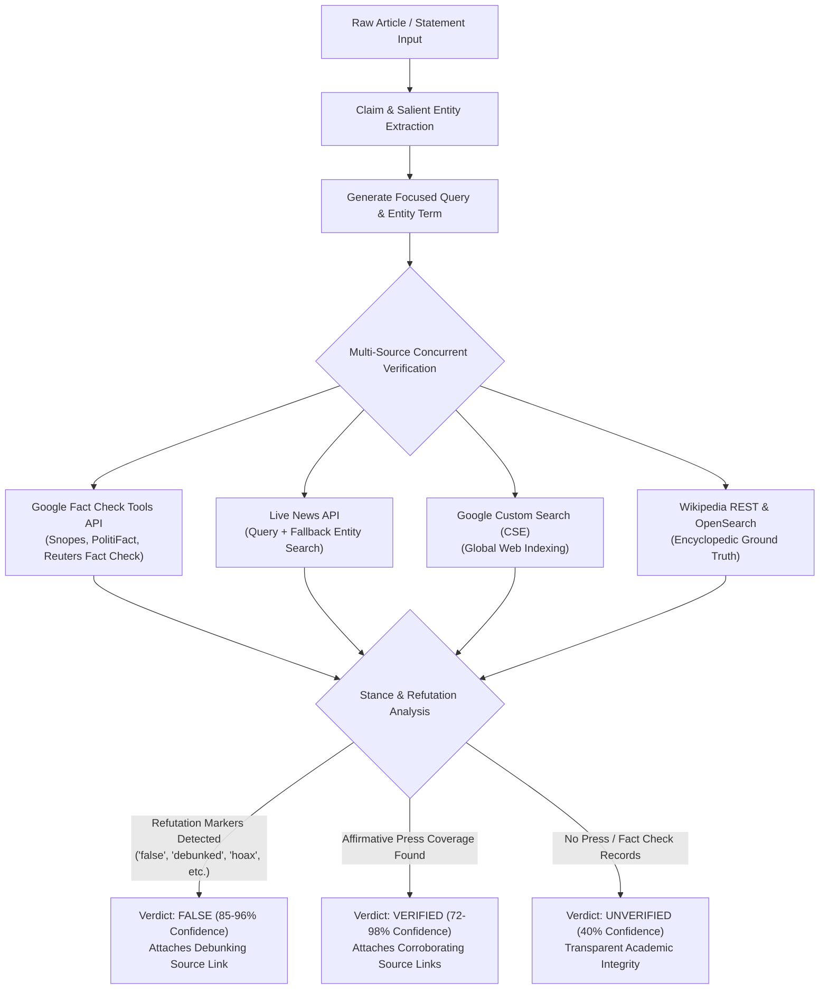

# Fact-Checking & External Corroboration Engine Upgrade

One of the central promises of VeritasAI is that it doesn't just guess whether text is true based on tone—it cross-references claims against live news archives, certified fact-checkers, and knowledge registries. This document explains the major overhaul implemented to turn our corroboration service from a prototype into an accurate, production-grade fact-checking engine.

---

## 1. The Core Problems with Naive Fact Checking

During our audit of the initial prototype, we discovered three critical flaws in claim verification:

1. **The "Word Overlap" Disinformation Trap:**
   A debunking article titled *"Fact Check: False claims that Pope Francis was arrested"* shares over 85% of its vocabulary with the fake claim *"Pope Francis was arrested"*. Using naive Jaccard word similarity without stance detection meant VeritasAI would find the debunking article and **falsely mark the fake claim as "Verified" (92% confidence)**!
2. **Naive Query Slicing:**
   The old code took the first 4 words of a claim arbitrarily. For a claim like *"Former President Donald Trump was convicted of 34 felony counts in New York"*, it searched `"former president donald trump"`, completely dropping *"convicted"*, *"felony"*, and *"New York"*.
3. **Mock Data Fallback:**
   When the News API quota was exceeded or rate-limited, the old code alternated between fabricating 92% "verified" Reuters claims and 45% unverified claims, which compromises academic and research integrity.

---

## 2. How the New Engine Works

---

## 3. Stance & Refutation Detection (The Crucial Accuracy Fix)

To prevent debunking articles from falsely confirming fake news, we implemented **Stance and Refutation Detection**. Every search result's headline, snippet, and fact-check rating is scanned for explicit refutation markers:

- Refutation keywords: `"fact check"`, `"false"`, `"debunk"`, `"debunked"`, `"hoax"`, `"unfounded"`, `"no evidence"`, `"denies"`, `"fake news"`, `"misleading"`, `"myth"`, `"not true"`, `"incorrect"`, `"fabricated"`, `"bogus"`, `"disproven"`, `"pants on fire"`.

### Decision Matrix:
- **If refutation markers are present:** VeritasAI recognizes the press is refuting the rumor. The claim status is set to `"false"`, the confidence is computed from the refuting outlets (85–96%), and the explanation directly quotes the debunking article:
  > *"Debunked by press and fact-checkers: 'Fact check: False claim that Pope Francis was arrested'. Published reports refute this claim as false, a hoax, or lacking factual basis."*
- **If no refutation markers and high semantic overlap:** VeritasAI recognizes affirmative news coverage. The claim status is set to `"verified"` with direct links to the reporting news agencies.
- **If no matching records exist:** VeritasAI returns an honest `"unverified"` rating. **No mock data is ever fabricated.**

---

## 4. Multi-Source Verification Pipeline

Instead of relying on a single news feed, the engine queries four independent services concurrently using `asyncio.gather`:

1. **Google Fact Check Tools API (`factchecktools.googleapis.com`):**
   Directly accesses ratings submitted by the International Fact-Checking Network (IFCN) signatories including Snopes, PolitiFact, Associated Press Fact Check, and Africa Check.
2. **News API (`newsapi.org/v2/everything`):**
   Searches live international news coverage. If the specific 6-word query returns no matches in recent press, the engine automatically attempts an entity query fallback to ensure breaking news is captured.
3. **Google Custom Search API (CSE):**
   Queries Google's global web index using custom search engine credentials.
4. **Wikipedia Knowledge Engine (`en.wikipedia.org`):**
   Provides fast, reliable, zero-quota encyclopedic ground truth for entity existence, historical events, scientific consensus, and public figures.

---

## 5. Salient Entity & Predicate Query Construction

Instead of taking arbitrary words, the `_extract_queries()` algorithm:
1. Strips passive attribution preambles (e.g., *"According to Reuters, ..."*).
2. Extracts capitalized proper nouns and acronyms (e.g., *"Pope Francis"*, *"Vatican"*, *"NASA"*, *"WHO"*).
3. Extracts action verbs and statistical data (e.g., *"arrested"*, *"temperature"*, *"1.2 degrees"*).
4. Filters common English stopwords and constructs both a high-precision search query (up to 6 terms) and an entity query (2–3 terms).

---

## 6. How to Enable Google APIs on Google Cloud Console

The project's Google API key is configured in `backend/.env`. To enable the Google Fact Check Tools API and Google Custom Search:
1. Open [Google Cloud Console](https://console.cloud.google.com/).
2. Select your project (`468496636741`).
3. Navigate to **APIs & Services > Library**.
4. Search for and click **Enable** on:
   - **Fact Check Tools API** (`factchecktools.googleapis.com`)
   - **Custom Search API** (`customsearch.googleapis.com`)
5. If disabled or rate-limited, VeritasAI automatically falls back to News API and Wikipedia without throwing errors.

---

## 7. Semantic Overlap & Predicate Alignment Safeguard

### The "Entity Overlap Contamination" Vulnerability
When querying external registries for public figures (e.g., *"Pope Francis"* or *"Elon Musk"*), broad search queries return numerous past debunked hoaxes (e.g., child trafficking hoaxes, fake quotes). Without strict predicate alignment:
- A benign headline like *"Pope Francis delivered a Sunday sermon on peace in Rome"* would return a Snopes fact check debunking *"Pope Francis was arrested during a blackout"*.
- Because both share the words `"Pope"` and `"Francis"`, a naive overlap check would find a match and mistakenly mark benign news as **FALSE**.

### The Multi-Stage Alignment Safeguard (`_is_claim_relevant`):
1. **Query Restraint:** Google Fact Check is queried exclusively using `concise_query` (entity + action root) and `salient_query` (top 6 salient claim tokens). Bare entity names are never used for fact-checking queries.
2. **Morphological Stemming:** Suffixes (`-ed`, `-ing`, `-es`, `-s`, `-tion`, `-ly`) are stripped to ensure inflectional equivalence (e.g., `arrested` matches `arrest`).
3. **Non-Entity Overlap Requirement:** If word similarity is below 0.50, the candidate match **must** contain content words outside the named entities. Matching only on proper names is immediately rejected.
### The "Third-Party Predicate Mismatch" Vulnerability & Subject Anchoring
The inverse vulnerability occurs when an article shares a specific predicate/action with a claim, but is about a completely different person or entity.
- Example: The claim *"The pope has been diagnosed with a rare cancer..."* shares words (`"diagnosed"`, `"rare"`, `"cancer"`) with an article reporting that BBC presenter Maryam Moshiri was diagnosed with polycythaemia vera.
- Without **Subject/Actor Anchoring**, naive token overlap yielded a 44% match, mistakenly verifying the Pope rumor using a BBC presenter's health report.
- **The Solution (`_extract_primary_actors` & Actor Containment):**
  The system extracts primary subjects/actors (`TITLES_AND_ROLES` + capitalized proper nouns). If the candidate article does not contain any of the primary actors specified in the claim (e.g. Maryam Moshiri article never mentions *"Pope"*, *"Francis"*, or *"Vatican"*), the candidate is **immediately rejected**.
  Furthermore, Wikipedia encyclopedic summaries require full relevance and action alignment before conferring verification.

---

*BSc IT Dissertation Notes — Michael Mazhambe*
