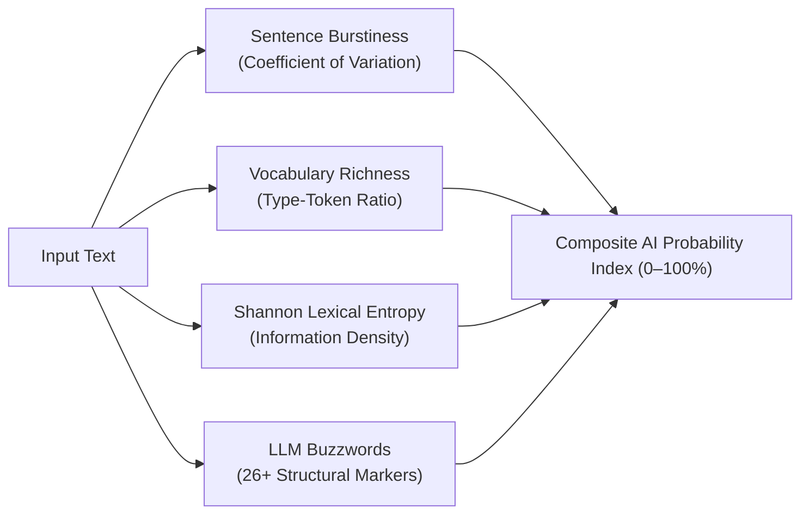

# Linguistic Analysis & Statistical AI Text Detection

The Linguistic Service (`backend/app/services/linguistic.py`) provides fine-grained sentence-level explainable AI (XAI) annotations and multi-factor synthetic text detection. This document details the improvements made to eliminate false attributions and strengthen AI detection.

---

## 1. Explainable AI (XAI) Annotation Engine

Every sentence submitted for analysis is classified into one of four categories:

1. **Manipulative (`AnnotationType.manipulative`):**
   Flags sensationalism, clickbait tropes, emotional hyperbole, and absolutist words (*"shocking"*, *"bombshell"*, *"unbelievable"*, *"everyone"*, *"proof"*, *"mind-blowing"*).
2. **Verified (`AnnotationType.verified`):**
   Identifies statements supported by verified journalistic attribution or empirical data citing legitimate institutions (*"Reuters"*, *"BBC"*, *"NASA"*, *"Nature Journal"*, *"World Health Organization"*).
3. **Unverified (`AnnotationType.unverified`):**
   Flags statements citing anonymous, fictitious, or ambiguous sources (*"some experts say"*, *"sources claim"*, *"an unverified report"*).
4. **Neutral (`AnnotationType.neutral`):**
   Objective assertions delivered in measured, factual language.

---

## 2. Fixing the Attribution Bypass Flaw

### The Problem:
In the initial prototype, if an author wrote:
> *"According to BBC, a mind-blowing conspiracy was exposed today."*

The parser saw `"According to"` and `"BBC"`, and immediately marked the entire sentence as **Verified (90% confidence)**, completely ignoring the sensationalist and manipulative language.

### The Solution:
We reorganized the evaluation pipeline:
- **Manipulative Pattern Precedence:** Sensationalist language is checked *first*. If manipulative framing is present, the sentence is flagged as manipulative with a 25.0 score regardless of whether an institution was named.
- **Strict Empirical Qualification:** Attribution to recognized institutions assigns 88.0, while statistical claims without an accredited publisher are marked as neutral empirical assertions (60.0).

---

## 3. Multi-Factor AI Generation Detection

LLM-generated text exhibits measurable statistical artifacts. Rather than relying on a single brittle classifier, VeritasAI combines four distinct stylometric metrics:

### 1. Sentence Burstiness (Cadence):
Human writers naturally vary sentence length (short punchy sentences followed by compound structures). LLMs typically produce uniform sentence lengths. We compute the Coefficient of Variation ($CV = \frac{\sigma}{\mu}$) of sentence lengths:
- $CV < 0.25$: Monotonous uniform cadence (+35% AI probability)
- $CV \ge 0.35$: Natural human cadence

### 2. Vocabulary Richness (TTR):
The Type-Token Ratio ($TTR = \frac{\text{Unique Words}}{\text{Total Words}}$) measures vocabulary variation:
- $TTR < 0.45$ in texts $> 50$ words (+25% AI probability)

### 3. Shannon Lexical Entropy:
Measures the information density and randomness of token choices:
$$H = -\sum_{i} P(w_i) \log_2 P(w_i)$$
- $H < 3.8\text{ bits}$: Repetitive, highly predictable token distribution characteristic of greedy or low-temperature decoding (+18% AI probability).

### 4. LLM Buzzword Frequency:
Tracks overused generative AI phrasing (*"delve into"*, *"tapestry of"*, *"testament to"*, *"crucial role"*, *"navigating the complex"*, *"in summary"*, *"multifaceted"*, *"beacon of"*, *"game-changer"*, *"paradigm shift"*, *"seamlessly integrate"*). Each detected marker increments the AI probability score.

---

*BSc IT Dissertation Notes — Michael Mazhambe*
